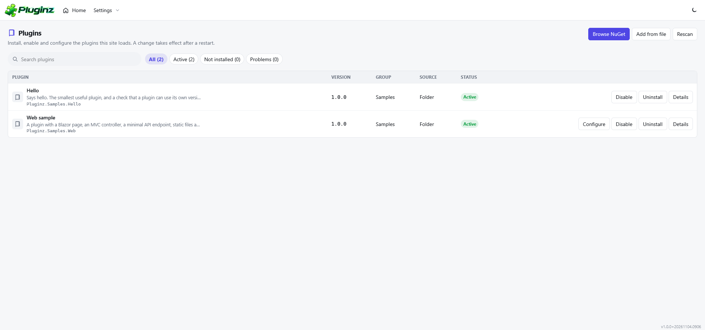
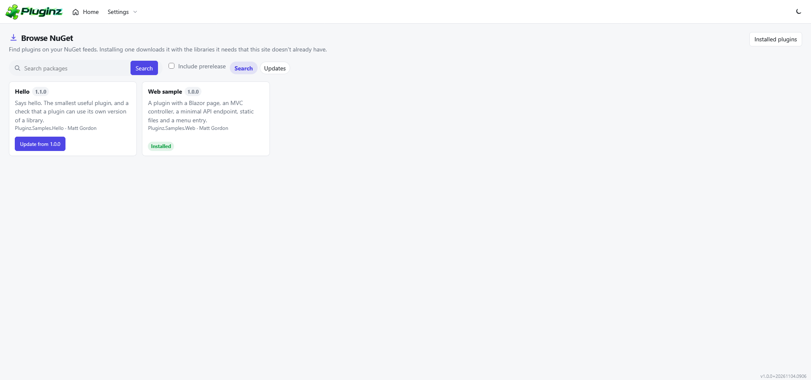
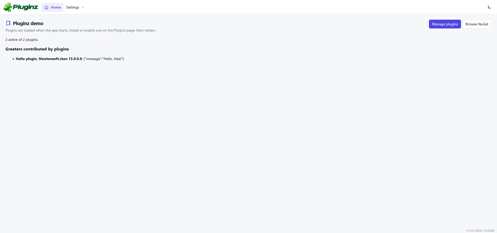

A plugin framework for ASP.NET Core and Blazor. A plugin is a folder, a `.zip`, or a NuGet package. An administrator installs, enables, disables and removes plugins from a NetForge admin page, and a plugin can add services, MVC controllers, minimal API endpoints, Razor components, menu entries and static files to the host.

Plugins load once, while the host starts, because that is the only moment a plugin can still add services to the container. Changes made on the admin page take effect after a restart, and the page says so.

## Screenshots







## Packages

| Package | What it is |
| --- | --- |
| `Pluginz.Core` | The contracts a plugin references (`IPlugin`, `PluginBase`, `PluginContext`, models) and the MSBuild props and targets that turn a project into a plugin. No loader, no UI. |
| `Pluginz.Services` | Discovery, loading, the registry, the manager, folder and zip installers, state storage. |
| `Pluginz.NuGet` | Search, install and update plugins from NuGet feeds, or install an uploaded `.nupkg`. |
| `Pluginz.Web` | Static files, MVC parts, endpoints and Blazor router assemblies for plugins. |
| `Pluginz.Components` | The NetForge admin pages: the plugin list and the NuGet browser. |

`Pluginz.Demo` is a runnable host and `samples/` holds two plugins. `Pluginz.Tests` has the xunit tests.

## Add it to a host

```csharp
var builder = WebApplication.CreateBuilder(args);

builder.Services.AddRazorComponents().AddInteractiveServerComponents();

builder.AddPluginz();                                   // discovers and loads plugins now
builder.Services.AddControllers().AddPluginzParts();    // plugin controllers and views
builder.Services.AddPluginzWeb();
builder.Services.AddPluginzNuGet();                     // optional
builder.Services.AddPluginzComponents();                // optional, the admin pages

var app = builder.Build();

app.UseStaticFiles();
app.UsePluginz();                                       // plugin wwwroot and middleware
app.UseAntiforgery();
app.MapControllers();
app.MapPluginz();                                       // plugin endpoints
app.MapRazorComponents<App>()
    .AddInteractiveServerRenderMode()
    .AddAdditionalAssemblies(typeof(Pluginz.Components.Pages.Plugins).Assembly)
    .AddPluginzAssemblies(app.Services);                // plugin @page components

app.Run();
```

The router needs the same assemblies. Inject `IPluginWebAssemblies` into `Routes.razor` and pass `Assemblies` to `AdditionalAssemblies`. See `Pluginz.Demo/Components/Routes.razor`.

Settings come from the `Pluginz` section (`appsettings.json`) and from the `Action<PluginzOptions>` you pass:

```json
{
  "Pluginz": {
    "PluginsPath": "Plugins",
    "DataPath": "App_Data/Pluginz",
    "ShadowCopy": true,
    "NuGet": {
      "TagFilter": "pluginz",
      "Sources": [
        { "Name": "Local feed", "Url": "feed" },
        { "Name": "nuget.org", "Url": "https://api.nuget.org/v3/index.json" }
      ]
    }
  }
}
```

A relative `PluginsPath`, `DataPath` or feed folder is relative to the content root.

## Write a plugin

A plugin project references `Pluginz.Core` and sets `IsPluginzPlugin`. The package imports the build props and targets, which enable dynamic loading, write a `.deps.json`, copy `wwwroot` to the output, keep the host's own assemblies out of the plugin folder and generate `plugin.json` from the project properties.

```xml
<Project Sdk="Microsoft.NET.Sdk">
  <PropertyGroup>
    <TargetFramework>net10.0</TargetFramework>
    <IsPluginzPlugin>true</IsPluginzPlugin>
    <PluginzSystemName>Acme.Reports</PluginzSystemName>
    <Title>Reports</Title>
    <Description>Scheduled reports.</Description>
    <Authors>Acme</Authors>
    <Version>1.0.0</Version>
    <PackageTags>pluginz</PackageTags>
  </PropertyGroup>
  <ItemGroup>
    <PackageReference Include="Pluginz.Core" Version="1.0.0" PrivateAssets="all" ExcludeAssets="runtime" />
  </ItemGroup>
</Project>
```

```csharp
public sealed class ReportsPlugin : PluginBase
{
    public override string? ConfigurationUrl => "/reports/settings";

    public override void ConfigureServices(IServiceCollection services, PluginContext context) =>
        services.AddSingleton<IReportService, ReportService>();

    public override Task InstallAsync(PluginRuntimeContext context, CancellationToken cancellationToken = default)
    {
        // Create tables, seed data. Runs when an administrator installs the plugin.
        return Task.CompletedTask;
    }
}
```

A plugin that adds web features also implements `IWebPlugin` (`Pluginz.Web`): `Configure` adds middleware and `MapEndpoints` maps endpoints. Controllers, Razor components and `wwwroot` are picked up without any code. Static files are served at `/_content/{AssemblyName}` and `/plugins/{SystemName}`.

`PluginContext` gives a plugin its `Configuration`, the `Plugins:{SystemName}` configuration section, its own `DataPath` and the host's content root. Contracts that the host and plugins share belong in a separate assembly that both reference, as `Pluginz.Samples.Contracts` does.

### The manifest

`plugin.json` sits at the root of the plugin folder, and in a package at `pluginz/plugin.json`. The build writes it for you. A folder without one still loads, when `{folder}/{folder}.dll` exists.

| Field | Meaning |
| --- | --- |
| `systemName` | Required. Letters, digits, `.`, `_`, `-`. Must match the folder name. |
| `version` | Required. A NuGet-style version. |
| `assembly` | The main DLL. Defaults to `{systemName}.dll`. |
| `hostVersion` | A version range the host must satisfy, for example `[1.0,2.0)`. A plugin that does not match is `Incompatible`. |
| `dependencies` | Other plugins that must be installed and enabled. They load first. |
| `privateAssemblies` | Libraries this plugin loads from its own folder even when the host ships them. |
| `tenants`, `roles` | Restrict who sees the plugin through `IPluginFinder`. Empty means everyone. |
| `friendlyName`, `group`, `author`, `description`, `displayOrder`, `tags`, `iconUrl`, `projectUrl`, `license` | Shown on the admin page. |

## How plugins are isolated

Each plugin gets its own `AssemblyLoadContext`, backed by an `AssemblyDependencyResolver` that reads the plugin's `.deps.json`. This is the model described in [Create a .NET application with plugins](https://learn.microsoft.com/en-us/dotnet/core/tutorials/creating-app-with-plugin-support) and [Understanding assembly loading](https://learn.microsoft.com/en-us/dotnet/core/dependency-loading/overview).

Types that cross the boundary must be the same type on both sides, so some assemblies always come from the host:

- the framework (`System.*`, `Microsoft.*`, `netstandard`) and every `Pluginz.*` assembly;
- by default (`PreferHost`), any assembly the host itself has. A plugin cannot accidentally load a second copy of a library the host already uses;
- anything in `Isolation.SharedPrefixes` or `Isolation.SharedAssemblies`.

A plugin that needs its own version of a library lists it in `privateAssemblies`. The sample `Pluginz.Samples.Hello` uses Newtonsoft.Json 12 while the demo host ships 13, and the Home page shows the version the plugin sees. Set `Isolation.Mode` to `Isolated` to share only the framework and Pluginz.

With `ShadowCopy` (the default) plugins load from a copy under `DataPath`, so the files in `Plugins/` are never locked and a plugin can be updated while the site runs. Native libraries under `runtimes/{rid}/native` and satellite resource assemblies resolve from the plugin folder.

Active plugins use ordinary load contexts, which cannot be unloaded. That is why a restart is needed to remove or replace a running plugin. The install and uninstall hooks run in a short-lived collectible context that is released afterwards.

## NuGet

`IPluginPackageService` searches feeds, lists versions, installs a package, installs an uploaded `.nupkg`, and reports updates for plugins that came from NuGet.

- Browsing lists only packages tagged `pluginz` (set `TagFilter` to change it, or to `null` for a feed that holds only plugins). nuget.org is searched with `tags:` and a folder feed is filtered after the search.
- Install picks the assets for `TargetFramework` (`lib/net10.0` and the nearest compatible folder), copies `runtimes/` and `staticwebassets/`, and reads `pluginz/plugin.json`.
- Dependencies are resolved as a closure. A dependency is skipped when the host already provides it (the framework, `Pluginz.*`, any assembly the host has), when it is a meta package, or when it is another installed plugin, in which case it becomes a manifest dependency. Everything else is downloaded into the plugin folder.
- A plugin can be installed from a folder, a `.zip` or a `.nupkg` as well, from the admin page or through `IPluginManager`, `IPluginArchiveInstaller` and `IPluginPackageService`.

Pack a plugin with `dotnet pack` and push it to a feed. `samples/pack-samples.ps1` packs the samples into `Pluginz.Demo/feed`, which the demo uses as a feed.

## Restart semantics

State lives in `{DataPath}/plugins.json`: whether each plugin is installed and enabled, the installed version and local overrides of name, order, tenants and roles. A change updates the file at once and the registry reports `RestartRequired`. Until the restart the plugin shows `Starts after restart` or `Stops after restart`.

Updating a plugin that is loaded replaces its folder (with `ShadowCopy`) or stages the new files in `{DataPath}/pending` and applies them at the next startup. If a plugin's `ConfigureServices` throws, its registrations are rolled back and it is reported as `Failed` while the host keeps starting, unless `ThrowOnLoadFailure` is set.

`AllowRestart` shows a Restart now button that stops the host through `IHostApplicationLifetime`. It is off by default, because only a supervisor such as IIS, systemd or a container restarts the process.

## Scope: tenants and roles

Implement `IPluginScope` (`TenantId`, `Roles`) and register it with `AddPluginz<TScope>()`. `IPluginFinder` then returns only the plugins whose `tenants` and `roles` allow the current scope. Without a scope everything is visible.

## Security

Installing a plugin runs its code in the host process with the host's permissions. Treat the ability to install as the ability to run code on the server.

- The admin pages and the manager are fail-closed. `RequireAuthentication` defaults to `true`, and `ReadPolicy` and `ManagePolicy` name authorization policies for viewing and for changing plugins.
- `AllowedPrefixes` is an allow-list of system-name prefixes for plugins that arrive by upload or from NuGet. Empty allows any name. `AllowUpload` turns uploads off. `MaxUploadMegabytes` caps an upload.
- Archives and packages are extracted with zip-slip protection, a cap on entries and a cap on unpacked size.
- NuGet package signatures are not verified. Use feeds you trust.
- Do not put feed passwords in `appsettings.json`. Use a secret store.

## Run the demo

```powershell
./samples/pack-samples.ps1          # optional, fills the local feed
dotnet run --project Pluginz.Demo
```

The demo builds the sample plugins into `Pluginz.Demo/Plugins`. Open `/pluginz`, install `Hello` and `Web sample`, restart, and look at Home and the Settings menu.

## Build and test

```powershell
dotnet build Pluginz.slnx
dotnet test Pluginz.Tests
```

## License

Apache-2.0.
